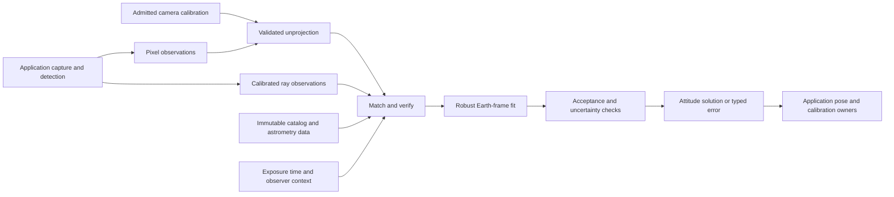

# Architecture

One native implementation supplies all language interfaces. See [validation](VALIDATION.md)
for the distinction between synthetic controls and physical qualification.

## Boundaries

Matching can use intermediate celestial representations, but final Earth-relative
fitting must use a consistent reference-direction model. Do not treat ICRS catalog
rays as apparent observed rays, or describe all astrometric corrections as one
rigid post-fit rotation. Refraction and other direction-dependent effects require
per-source evaluation. Applied and omitted corrections remain visible.

## Implemented packages

| Target | Responsibility | Production dependency |
| --- | --- | --- |
| astroattitude | Resource validation, camera geometry, matching, reference evaluation, fitting and acceptance | Yes |
| astroattitude_c | Versioned JSON/opaque-handle C boundary over the same implementation | Yes, for bindings |
| Swift/Python/Kotlin adapters | Native value conversion and ownership | Consumer-specific |
| aa_benchmark / aa_tests | Synthetic fixtures, quantitative cohorts, test-only fault and cancellation controls | No |
| aa_propagate / tools/convert.py | Explicit local-file conversion and provenance | No |
| Tests and reference fixtures | Independent oracles, regressions, rejection and performance evidence | No |

CMake separates these targets. The production library does not link diagnostic object files or expose bypass flags. Ordinary typed errors,
resource identities and match reports are production observability, not diagnostic
bypasses.

## Execution and state

An engine holds immutable resource snapshots and precomputed indexes. Per-call
workspace is independent. No background thread, singleton catalog, current-time
lookup, implicit location, hidden previous solution, network fetch or process-global
random state is part of the contract. Deterministic ID ordering and versioned local
search policy are required; cross-platform floating-point equality is not
promised, but classifications and results must agree within declared tolerances.

Input, hypothesis, comparison and workspace budgets are explicit. API.md and
RESOURCES.md define package/index/engine caps. Synthetic benchmark workloads do not
establish a portable runtime or physical-accuracy guarantee.
Resource replacement requires constructing a new engine; an in-flight call retains
its original snapshot. Versioned resources may be shared safely across callers.

## Uncertainty and precision

Uncertainty is not synonymous with in-fit residual. V1 reports only independent
measurement-noise covariance conditional on accepted IDs, final weights and fixed
nuisance parameters. Shared calibration/catalog/time/EOP/refraction errors and
selection uncertainty are excluded explicitly. Unknown measurement noise yields
null, never a residual-derived floor. Full propagation is deferred; consuming fusion
must not treat conditional covariance as its entire physical measurement budget.

The consuming application owns geographic position, calibrated camera/device/GNSS
offsets, IMU fusion, correlation with prior observations, calibration activation and
freshness. A solve result is a timestamped measurement, not permission to mutate
those owners or rewrite historical evidence.

## Dependencies and resource admission

Pinned source dependencies and their notices are recorded under `cmake/` and
`notices/`. Catalog and time resources are caller-provided. Numerical schema
validation does not establish trust or redistribution rights. No captured data is
bundled. See [resource contracts](RESOURCES.md).
